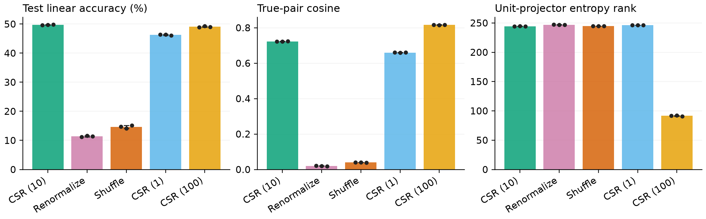

# Centroid Soft Rank (CSR)

Research code for **Centroid Soft Rank: Agreement and Spectral Diversity in Self-Supervised Visual Learning**.

CSR applies a smooth, scale-sensitive rank score to the averaged representations of two augmented views. It uses one explicit spectral loss: view agreement preserves centroid energy, while the saturating spectral reward encourages distributing that energy across directions.

This repository contains the training implementation, matched VICReg and two-view MMCR controls, CIFAR/ImageNet-subset runners, mechanism ablations, numerical checks, and recorded aggregate/per-seed results.

## Objective

Normalize the two projector outputs independently, then average them **without normalizing the centroid again**:

```python
u = F.normalize(z, dim=1, eps=1e-6)
v = F.normalize(z_prime, dim=1, eps=1e-6)
c = (u + v) / 2
r = min(c.shape)
eigenvalues = torch.linalg.svdvals(c / math.sqrt(c.shape[0])).square()
loss = 1 - (1 + kappa) / r * (eigenvalues / (eigenvalues + kappa / r)).sum()
```

The reported configuration uses `kappa=10`. See [losses/rank_only.py](losses/rank_only.py) for the implementation and [the mathematical notes](docs/METHOD.md) for the exact decomposition and qualifications.

## Installation

Python 3.11 was used in the recorded experiments. From the repository root:

```bash
python3 -m venv .venv
source .venv/bin/activate
python -m pip install --upgrade pip
python -m pip install -r requirements.txt
python -m pytest -q
python check_theory.py
```

`requirements.txt` records the observed package versions. Choose a PyTorch installation compatible with your GPU/driver using the [official installation instructions](https://pytorch.org/get-started/locally/). Full experiment runners require CUDA and refuse accidental CPU training. The recorded hardware was an NVIDIA RTX 4090; these settings are not a minimum-memory guarantee for other systems.

## Data

The default data directory is `./data`. CIFAR-10, CIFAR-100 and MNIST use torchvision and download when needed. For the two ImageNet subsets:

```bash
mkdir -p data
wget -c https://cs231n.stanford.edu/tiny-imagenet-200.zip -O data/tiny-imagenet-200.zip
unzip -q data/tiny-imagenet-200.zip -d data
wget -c https://s3.amazonaws.com/fast-ai-imageclas/imagenette2-160.tgz -O data/imagenette2-160.tgz
tar -xzf data/imagenette2-160.tgz -C data
python run_benchmarks.py check --data-root ./data
```

Expected directories: `data/tiny-imagenet-200` and `data/imagenette2-160`. Dataset rights remain with their respective providers. Tiny ImageNet's official validation annotations are loaded directly; no manual folder rearrangement is needed.

## Reproduce the experiments

Run commands from this repository's root. Runs execute sequentially. Repeating a command reuses completed results or resumes checkpoints only when source/config provenance matches.

### CIFAR comparisons: 30 epochs, three seeds

```bash
python -u run_cifar.py --datasets cifar10 cifar100 --data-root ./data
```

This runs CSR, MMCR, and VICReg with seeds 0, 1, 2 on both datasets. To start with one condition:

```bash
python -u run_cifar.py --datasets cifar100 --methods csr_k10 --seeds 0
```

### ImageNet subsets: pilots and final comparisons

```bash
python -u run_benchmarks.py pilot --datasets tinyimagenet imagenette --data-root ./data
python -u run_benchmarks.py final --datasets tinyimagenet imagenette --data-root ./data
python run_benchmarks.py summary
```

Pilots are 10 epochs/seed 0 and evaluate internal validation only. Final runs start from scratch for 100 epochs/seeds 0, 1, 2. Official validation sets are held out from training and probe tuning; internal tuning sets come from official training images.

### CIFAR-100 mechanism ablations

```bash
python -u run_ablations.py run --data-root ./data
python run_ablations.py summary
```

Fifteen runs: original CSR at κ=10, renormalized centroids, shuffled training pairs, CSR at κ=1, and CSR at κ=100; each uses 30 epochs and three seeds. A small pipeline check is available:

```bash
python -u run_ablations.py smoke --cpu --data-root ./data
```

Smoke scores are not scientific results. Original screening/supplement configurations are under `configs/`; run one using `python train_ssl.py --config PATH`. Some supplemental configurations are untrained controls with zero SSL epochs.

## Recorded results

Mean ± sample standard deviation over three training seeds. These are frozen-encoder linear accuracies; CIFAR uses official test data, and the ImageNet subsets use held-out official validation data.

| Method | CIFAR-10 | CIFAR-100 | Tiny ImageNet | Imagenette |
|---|---:|---:|---:|---:|
| CSR | 78.31 ± 0.12 | 49.69 ± 0.10 | 39.43 ± 0.61 | 80.56 ± 0.74 |
| MMCR control | 76.03 ± 0.18 | 47.77 ± 0.75 | 36.91 ± 0.40 | 77.45 ± 0.27 |
| VICReg | 78.35 ± 0.17 | 46.11 ± 0.65 | 40.23 ± 0.21 | 81.04 ± 1.05 |

CSR has the highest mean kNN accuracy on these four datasets, but does **not** have the highest linear mean on every dataset. The Imagenette kNN margin over VICReg is small and uncertain with three seeds. See [full results and caveats](docs/RESULTS.md), [CIFAR per-seed data](docs/cifar_results.json), and [extension/ablation data](docs/extension_and_ablation_results.json).



Renormalizing the centroid or destroying correct training correspondence sharply reduces accuracy and true-pair agreement, despite high projector entropy rank. This supports the proposed mechanism under the tested recipe, rather than proving convergence or universal superiority.

## Scope and reproducibility

- CIFAR runs use gradient clipping at 10; ImageNet-subset runs disable it for all methods. Budgets, resolutions and architectures differ across datasets.
- Baselines share a recipe rather than receiving independent tuning budgets. The MMCR control is a scaled, two-view objective, not a reproduction of its published training recipe.
- Data ordering and augmentations are deterministic by seed. Configuration/source hashes guard resumption. Changed release paths/source files mean this code should use fresh output directories rather than historical checkpoints.
- The release combines the executed experiment implementations and makes data paths portable. It contains no datasets, model weights, feature caches, or private machine paths.
- The mechanism CSR control repeats the original seeds; it is not an additional independent sample.
- No full ImageNet-1K result, semantic recovery theorem, or optimization convergence guarantee is claimed.

## References

CSR builds on the centroid construction in [MMCR](https://arxiv.org/abs/2303.03307) and the established ridge effective-dimension functional. [VICReg](https://arxiv.org/abs/2105.04906) is a matched baseline. [PEIRA](https://arxiv.org/abs/2605.17671) is relevant related work, but was not trained as a baseline here. Bibliographic entries are in [references.bib](references.bib).
